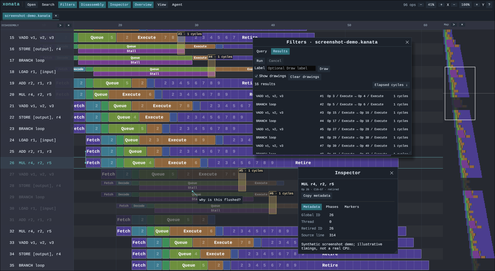

# Xonata

> [!WARNING]
> Beware! This is a completely vibecoded project...

A Rust viewer for Kanata v4 pipeline traces. Runs natively or in a browser through WebAssembly, without Electron. Browser traces stay local.



- **Explore several traces:** tabs and split view, independent cycle/row zoom, numbered cells for long phases, and a clickable whole-trace minimap like in VSCode.
- **Find every match:** literal or regex search across disassembly and metadata, matching snippets, filters, and navigation to the first phase.
- **Analyze phase relationships:** Find stalls and longest phases by elaborate filters with visual showcase.
- **Measure and annotate:** draggable grid markers show cycle and row distances, your comment bubbles point to specific trace locations.
- **Keep the trace central:** resizable disassembly and inspector overlays, aligned rows, metadata tooltips, and a minimal monospace interface.
- **Handle large logs:** worker-based parsing, paged temporary storage, and a bounded decoded-page cache.

## Run

Install Rust (the repository toolchain includes the WASM target).

```sh
cargo run -p xonata-app
```

Use **Open** or drag in `.log`, `.gz`, or `.zst` traces.

For the browser build, generate a local lockfile and install its matching `wasm-bindgen-cli`:

```sh
cargo generate-lockfile
xonata_bindgen_version="$(python3 -c 'import pathlib, tomllib; print(next(p["version"] for p in tomllib.loads(pathlib.Path("Cargo.lock").read_text())["package"] if p["name"] == "wasm-bindgen"))')"
cargo install wasm-bindgen-cli --version "$xonata_bindgen_version" --locked
bash scripts/build-web.sh
python3 -m http.server 8000 --directory web
```

Open <http://localhost:8000/>. For integration, see [the embedding example](web/embed-example.html): `WebHandle` exposes `start(canvas)`, `open_file(file)`, `navigate(traceId, decimalOpId)`, and `destroy()`.

For a local preview of the deployment artifact:

```sh
bash scripts/build-pages.sh
python3 -m http.server 8000 --directory target/pages
```

## Controls

| Action | Control |
| --- | --- |
| Search / close popup | **F** or **Ctrl+F** / **Esc** |
| Phase / interval filtering | **Filters** → **Query / Results**, then **Run / Draw** |
| Next / previous match | **n / p**; offers a popup before wrapping |
| Horizontal zoom in / out | **Ctrl+Right / Ctrl+Left** |
| Vertical zoom in / out | **Ctrl+Up / Ctrl+Down** |
| Zoom both axes / pan / scroll | **Ctrl+wheel** or pinch / drag / wheel |
| Pan with keyboard | **Shift+arrows** (192 pixels per step; hold to repeat) |
| Place / move / remove marker | **Shift+click** / drag its dot / hover its dot and press **Delete** |
| Copy an area for an agent question | **Ctrl+drag** on the timeline, then **Copy for agent**; **Esc** or **Clear** removes the selection |
| Place / edit comment | **C**, then click the trace / click its bubble |
| Save / newline / cancel comment | **Enter / Shift+Enter / Esc** |
| Remove comment | Hover its bubble and press **Delete**, or use **Delete** in its editor |
| Toggle whole-trace overview | **M** or **Overview** in the header |
| Hotkeys guide | **?** |

The overview fits all pipeline rows and cycles into a full-height strip. Click or drag to jump to a row’s first phase; the white indicator tracks the current viewport. Drag its left edge to resize, use **> / <** to expand or compact it, or **×** to hide it.

Shortcuts for letters, keyboard panning, and zoom are inactive while typing. **X/Y** percentages reset each zoom axis. Click a phase or disassembly row to inspect metadata. Drag the disassembly edge to resize it; **> / <** expands or compacts it. **Inspector → Markers** provides editing, **×** removal, and **Clear markers**. Markers and comments last for the session and belong to their trace tab. Comments accept pasted text and follow the cycle/row grid during pan and zoom. Press **Esc** to cancel comment placement. **View** contains split view, the flushed-operation filter, and jumps by operation or retired ID.

## Phase and interval filters

Open **Filters → Query** and choose **Single phases** or **Intervals between phases**. Fill in instruction, phase, and metadata fields; empty fields accept any value. **▾** offers up to 16 suggestions from the loaded trace. Type to narrow them, or enter your own value. Suggestions are examples, not an exhaustive list.

Instruction and metadata use case-insensitive **contains** matching. Use `*` to match any text within a line: `FREE RQU *=36` can occur anywhere in a metadata line. Phase and lane fields match whole names, with wildcards available.

For the example interval, fill in:

| Field | From | To |
| --- | --- | --- |
| Instruction contains | `vfirst` | `vmsne` |
| Phase is | `E` | `E` |
| Boundary | End | Start |
| Metadata contains | `FREE RQU *=36` | empty |

**Results** defaults to **Delays only (≥ 0 cycles)**. Choose **Overlaps only** or **Delays and overlaps** to include negative gaps. The gap is target cycle − source cycle; negative means the target started before the source ended. Each source occurrence pairs with the next matching later instruction row in the same thread. Gap constraints apply *after* pairing; excluded overlaps do not choose a more distant target. Repeated target phases use their earliest matching endpoint. Unknown requested End boundaries are skipped and counted.

**More conditions** adds lane/status constraints, numeric comparisons (duration, cycle, operation/global/retired ID, thread), scoped metadata contains fields, and explicit regex fields. **Advanced pairing and drawing** contains target skip count, gap and row-distance limits, drawing row span, and padding.

For interval queries, enable **Exclude between (optional)** and fill in the same instruction, phase, boundary, metadata, and advanced fields as FROM/TO. Choose **Intervening rows** to check only rows strictly between the endpoints, or **Any pipeline row** to check all rows, including other threads. A pair is rejected when a matching Start/End boundary falls strictly inside its cycle interval; boundaries exactly at FROM/TO do not count. Negative intervals use the same two cycle bounds, and a zero-length interval has no interior. Exclusion is checked after pairing and never substitutes a later TO. Disable the section to keep its values without applying them.


Press **Run** after loading finishes. **Results** lists numbered matches with cycle counts; click one to jump without changing zoom. **Draw** replaces this trace's previous drawing set, using an optional label. **Show drawings** toggles visibility; **Clear drawings** removes them. Single-phase drawings follow lane slabs; intervals normally span both endpoint rows. At most **2,048 visible rectangles** are drawn, with the selected result prioritized. All matches remain in the paged list. Drawings and query state last for the session; drawing reveals flushed rows to preserve row geometry.

In **Results**, click **Elapsed cycles ↓ / ↑** to toggle highest-first / lowest-first sorting. Result numbers stay stable, and **Draw** includes all matches regardless of their order. Rectangle labels show the result number and elapsed cycles, including a negative count and “overlap” for overlapping intervals.

Filters match each pipeline row directly; separate micro-operation rows are not automatically associated with a parent instruction. A trace may put `E` on a named instruction and `vE` on a separate `MOP` row.

Browser embeds can observe `xonata:filter_suggestions`, `xonata:filter_progress`, `xonata:filter_results`, `xonata:filter_sort_progress`, `xonata:filter_sorted_results`, `xonata:filter_drawn`, `xonata:filter_drawing`, and `xonata:filter_error` canvas events (JSON detail). Filter IDs, cycles, row indexes, counts, and elapsed values are decimal strings to preserve precision.

Development and verification instructions are in [AGENTS.md](AGENTS.md). Bundled Liberation Mono fonts include their [license](crates/app/assets/fonts/LICENSE).

## Trace analysis agent

**Agent** opens a session-only conversation for the active trace after loading finishes. Enter or **Send** submits a question; **Cancel** stops the current analysis. Conversations retain follow-up context independently per tab. Closing the panel leaves its run active; closing its trace cancels the run. Text editing keeps canvas shortcuts inactive.

Expand **LiteLLM connection** in the chat window to enter the **Base URL**, **Model**, and masked **API key**, then click **Apply**. Base URL and Model start with editable example values (`http://localhost:4000/v1` and `rig-chat`); replace them with your endpoint and model. The API-key field starts empty. The section opens automatically when no connection is configured. Settings apply to every tab and stay in memory; **Apply** or **Clear connection** cancels active analyses across tabs. **Clear connection** also empties the key and resets the URL and model to their example values. Native environment settings and the browser host API remain supported and populate the same form.

The agent uses Rig with an OpenAI-compatible chat-completions endpoint, including LiteLLM. Rust 1.97.1 or newer is required. For native use:

```sh
export LITELLM_API_KEY='your-session-key'
export LITELLM_BASE_URL='http://localhost:4000/v1'
export LITELLM_MODEL='rig-chat'
cargo run --release -p xonata-app
```

The endpoint and model default to the values above; an API key is required. Unconfigured viewers continue working with agent access unavailable.

On the standalone page, configure the mounted viewer from the browser console using `window.xonata`:

```js
window.xonata.configure_agent(JSON.stringify({
  base_url: 'https://your-compatible-proxy.example/v1',
  api_key: 'your-api-key',
  model: 'your-model',
}));
// Cancel active analyses and clear the connection:
window.xonata.clear_agent_configuration();
```

The standalone page's `viewer` name refers to the canvas element, not the application handle. Embedded hosts call these methods on their own `WebHandle` instance, as shown in the embedding example.

Configuration and conversations stay in memory. Browser requests go directly to the configured endpoint, which must allow the page's origin through CORS. Keys supplied to a browser are accessible to that browser; use a session-scoped proxy credential. Trace snippets requested by tools are sent to the configured model endpoint. The standalone Pages site does not embed credentials or configure a backend automatically. See [the embedding example](web/embed-example.html).

For local browser testing when the external endpoint does not allow CORS, use the Python 3.8+ standard-library proxy. Run from the repository root:

```sh
bash scripts/build-web.sh
# Upstream origin only: no /v1, path prefix, or trailing slash.
export XONATA_LITELLM_UPSTREAM='https://litellm.example.com'
python3 scripts/agent-proxy.py
```

Open `http://localhost:8000` and enter `http://localhost:8000/llm/v1`, your model, and key under **Agent → LiteLLM connection → Apply**. Alternatively, configure the viewer in that page's console:

```js
window.xonata.configure_agent(JSON.stringify({
  base_url: `${location.origin}/llm/v1`,
  api_key: 'your-existing-litellm-key',
  model: 'your-model',
}));
```

The [local proxy script](scripts/agent-proxy.py) serves `web/` and strips `/llm` before forwarding GET/POST requests and their authorization header to the configured server. The viewer's `base_url` must point to the local `/llm` route, not the remote server. `location.origin` keeps requests on the page's origin even when opening `127.0.0.1` instead of `localhost`, so the upstream server needs no CORS change. If the upstream uses `/chat/completions` without `/v1`, use `${location.origin}/llm` as the viewer's base URL. The server defaults to IPv4 loopback; the key stays in the viewer's session configuration. Stop it with **Ctrl+C**. Use `--port 8001` to change the port, or `--upstream https://litellm.example.com` instead of the environment variable. This setup applies to the locally served page, not the GitHub Pages site. No Python packages are required.

To serve from a VM on all IPv4 interfaces, stop any existing server on the chosen port and run:

```sh
python3 scripts/agent-proxy.py --port 80 --bind 0.0.0.0 \
  --upstream https://litellm.example.com
```

Open `http://<vm-address>` and use the same `location.origin` configuration above. Binding port 80 may require permission to use privileged ports.

Tools inspect trace metadata, unfiltered rows, operation stages and dependencies, instruction searches, and phase/interval queries with signed elapsed sorting. Agent queries share trace pages but have independent query state and temporary indexes, preserving viewer searches, filters, and drawings. Tools do not navigate or modify the viewer. Replies cite observed operation IDs and cycles; interpretation remains model-generated.

The agent's bundled knowledge base currently contains a [Kanata trace description](crates/agent/knowledge/kanata-trace.md), summarized from the upstream format specification with its source link. Only titles and IDs are advertised in the `read_specification` tool; document text enters context when the agent requests a page (up to 2048 UTF-8 bytes). Retrieved pages remain in that analysis's tool history, but are not retained in subsequent questions. Both native and web builds use bundled text, with no embedding model or runtime web fetch. To bundle another specification, add a Markdown file under `crates/agent/knowledge/`, register its ID, title, and `include_str!` in [knowledge.rs](crates/agent/src/knowledge.rs), and rebuild.

To ask about an area, **Ctrl+drag** on the timeline and click **Copy for agent**, then paste into your question. The copied text includes inclusive cycle and operation ID bounds, zero-based unfiltered row bounds, and flushed-operation visibility. Operation IDs may have gaps; the area describes rows within a cycle interval, not necessarily overlapping stages for every operation. The selection stays in its tab for the session and clears when row visibility changes. Selecting or copying does not send a model request.

Each tab permits one run, with two runs globally. A run is limited to 120 seconds, 16 model turns, and 32 tool calls. Result pages default to 20 items and are capped at 64, with tool output capped at 64 KiB and truncation indicated. Conversations retain at most 32 messages and 64 KiB; final replies are capped at 32 KiB. Closing a trace, changing configuration, cancelling, or finishing releases run-owned indexes.

Agent tests use deterministic local mock responses and require no external credentials:

```sh
cargo test --workspace --locked
node scripts/browser-agent-smoke.mjs
```

The browser agent check requires the same WASM build, Node.js, and Chromium as the existing browser smoke check. It exercises model/tool round trips, phase sorting, follow-up context, and cancellation against a local mock endpoint.
